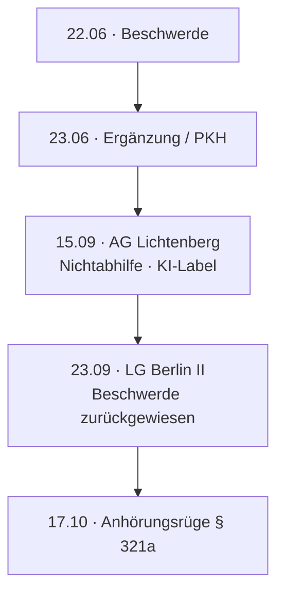

# AI — „pseudojuristischer Vortrag“

AG Lichtenberg and LG Berlin II decisions that labelled the filings as *mit künstlicher Intelligenz erstellter pseudojuristischer Vortrag*, plus Beschwerde filings and the § 321a Anhörungsrüge.

Each PDF has a companion `.txt` extract. 

---

## Index

| File | Role |
|------|------|
| [`2026-06-22 - Beschwerde.pdf`](2026-06-22%20-%20Beschwerde.pdf) · [`.txt`](2026-06-22%20-%20Beschwerde.txt) | Sofortige Beschwerde vs. AG Lichtenberg 04.06.2026 |
| [`2026-06-23 - Beschwerde.pdf`](2026-06-23%20-%20Beschwerde.pdf) · [`.txt`](2026-06-23%20-%20Beschwerde.txt) | Ergänzende Begründung / PKH |
| [`2026-09-15 - Lichtenberg Beschluss.pdf`](2026-09-15%20-%20Lichtenberg%20Beschluss.pdf) · [`.txt`](2026-09-15%20-%20Lichtenberg%20Beschluss.txt) | Nichtabhilfe — *KI … pseudojuristischen Vortrag* |
| [`2026-09-23 - LG II Beschluss.pdf`](2026-09-23%20-%20LG%20II%20Beschluss.pdf) · [`.txt`](2026-09-23%20-%20LG%20II%20Beschluss.txt) | Beschwerde zurückgewiesen |
| [`2026-10-17 - Anhörungsrüge.pdf`](2026-10-17%20-%20Anh%C3%B6rungsr%C3%BCge.pdf) · [`.txt`](2026-10-17%20-%20Anh%C3%B6rungsr%C3%BCge.txt) | § 321a ZPO vs. LG II 23.09.2026 |

---

## Chain

